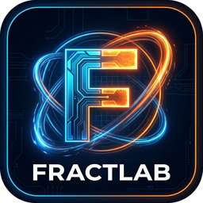
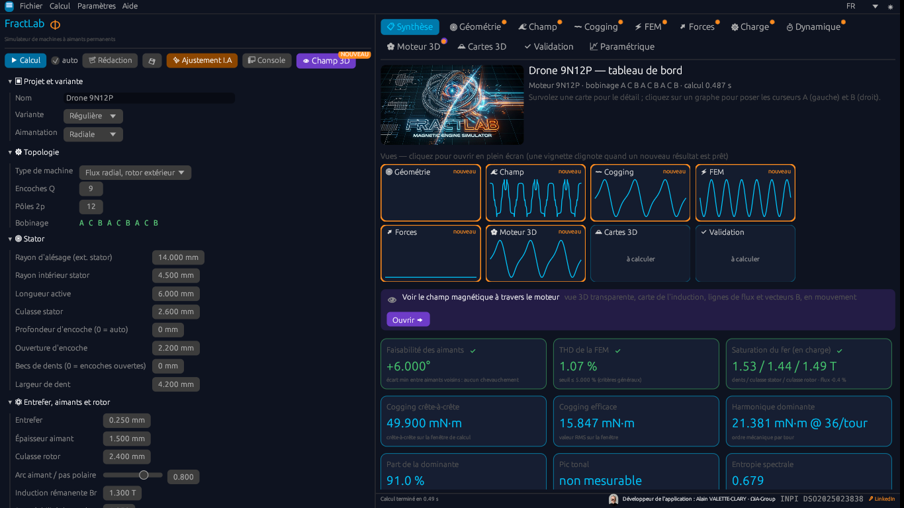
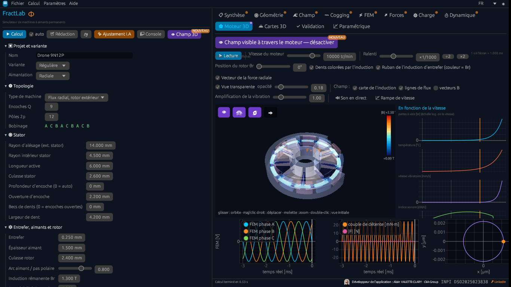

<p align="center"></p>

<h1 align="center">FractLab</h1>

<p align="center">[Français](README.md) · [English](README.en.md) · [Español](README.es.md) · [Italiano](README.it.md) · [Deutsch](README.de.md)</p>

<p align="center">Magnetic Engine Simulator — freie Analysesoftware für Permanentmagnetmaschinen, ersetzt MATLAB für Studien und Prüfstände.</p>

<p align="center">
<a href="https://github.com/OMNIA-AI-Group/FractLab/releases"></a>


</p>

<p align="center"><b>Neueste Version herunterladen</b><br>
<a href="https://github.com/OMNIA-AI-Group/FractLab/releases/latest/download/FractLab-x86_64.AppImage"></a>
<a href="https://github.com/OMNIA-AI-Group/FractLab/releases/latest/download/FractLab-Setup.exe"></a>
<a href="https://github.com/OMNIA-AI-Group/FractLab/releases/latest/download/FractLab-windows-portable.zip"></a>
<a href="https://github.com/OMNIA-AI-Group/FractLab/releases/latest/download/FractLab.html"></a>
<a href="https://omnia-ai-group.github.io/FractLab/"></a>
</p>



## Was ist FractLab?

FractLab analysiert Permanentmagnetmotoren — Außenläufer, Innenläufer und Axialfluss — mit einem exakten analytischen Modell (Maxwell-Gleichungen, gelöst über Teilgebiete). Anders als klassische Werkzeuge akzeptiert es **jede Magnetverteilung**, auch aperiodische (versetzte Magnete, beliebige Positionen).

Es ersetzt MATLAB für diese Arbeit: es öffnet SIMUMSAP-Projekte und MATLAB-Dateien `.fig` / `.mat` ohne MATLAB und geht weiter mit Live-Optimierung, Sättigung, Parameterstudien und Kalibrierung an Prototyp-Messungen. Alles läuft offline, auf allen Prozessorkernen, auf Französisch, Englisch, Spanisch und Deutsch.

## Funktionen

- **Feld und Moment**: Luftspaltinduktion, Feldkarte mit Flusslinien, Rastmoment und Spektrum, EMK (THD, Zwischenharmonische), Radialkräfte und Orbit, Exzentrizität (einseitiger magnetischer Zug).
- **Topologien**: Außen- oder Innenläufer, Axialfluss mit Mehrschichtmodell (1 oder 2 Luftspalte), halbgeschlossene Nuten, allgemeine Wicklung Spule für Spule. Axialmaschinen werden als Scheiben dargestellt (Vorderansicht, Axialschnitt, 3D); Feld je Scheibe und über die ganze Scheibe; Querkraft, axiale Anziehung, axialer Versatz und Neigung des Rotors; Validierung mit Finiten Volumen in ebener Geometrie.
- **Unter Last**: Moment (Maxwell) mit Energieprüfung, Welligkeit, Kt, Induktivitätsmatrix + Wickelköpfe, Verluste und Wirkungsgrad.
- **Sättigung**: Sättigungsfaktor-Methode mit realen B(H)-Kurven (M270-35A, M400-50A, SMC, Stahl 1010): Induktionen in Zähnen und Jochen, korrigierte EMK und korrigiertes Moment, Moment-/Strom-Kurve.
- **Dynamik**: Zeitbereichssimulation mit Netz, PWM-Wechselrichter, 120°-Kommutierung (ESC) oder Diodengleichrichter; Lasten Propeller, Förderband, Windturbine; Fehler offene Phase und Windungsschluss.
- **Animierter 3D-Motor**: reale Drehzahl bis 60 000 U/min mit Zeitlupe; Feld, Verluste, Wärme, Schwingung (ISO 10816) und synthetisierter Ton folgen der Drehzahl. Transparente Ansicht mit dem Magnetfeld im Inneren: Induktionskarte, Flusslinien, B-Vektoren.
- **KI-Optimierung**: automatische Optimierung (Rastmoment, Kraft, EMK oder Kompromiss), die live die 5 besten Lösungen vorschlägt und während der Suche auf alle Ansichten anwendet.
- **Konsole und 3D-Graph**: Live-Ablauf jedes K.I.-Versuchs, rotierender 3D-Graph der erkundeten Möglichkeiten, Skriptkonsole zum Verketten von Berechnungen.
- **Demo** (Menü Hilfe): eine vollständige Studie läuft selbstständig mit einem Demo-Motor (Drohne, Servomotor, Nabenmotor, Axialgenerator); Esc beendet sie.
- **Parameterstudie**: ein Parameter variiert, der ganze Motor wird je Wert neu berechnet; Kurven, Tabelle, CSV-Export.
- **Kalibrierung an Messungen**: gemessene EMK oder gemessenes Rastmoment importieren; tatsächliches Br, Luftspalt oder wirksame Länge werden angepasst.
- **Validierung**: integrierter unabhängiger Finite-Volumen-Löser (typische Abweichung 0,3 bis 2 %).
- **Kriterien**: das Dashboard meldet jedes nicht erfüllte Kriterium; ein Klick erklärt Ursache und Abhilfe.
- **Redaktion**: Projektblatt → LaTeX-/PDF-Dokument in 4 Sprachen mit Logo und Version von FractLab, Drucken, Ordner für die Gesamtsicherung.
- **Import / Export**: SIMUMSAP-Projekte, MATLAB `.fig`/`.mat` (Lesen und Schreiben), FEMM, Gmsh, DXF, 1:1-Positionierschablone für Magnete als SVG, STL, HTML, LaTeX, Octave/MATLAB- und Python-Skripte, CSV, JSON, WAV.



## Download

**Online ausprobieren, ohne Installation:** https://omnia-ai-group.github.io/FractLab/ (dieselbe Anwendung im Browser; die Berechnungen laufen in einem Web Worker im Hintergrund und sind langsamer als in der Desktop-Version; Dateien werden heruntergeladen, mehrere Dateien als ZIP-Archiv).

Fertige Pakete gibt es auf der Seite [Releases](https://github.com/OMNIA-AI-Group/FractLab/releases):

| Datei | System | Installation |
|---|---|---|
| [`FractLab-x86_64.AppImage`](https://github.com/OMNIA-AI-Group/FractLab/releases/latest/download/FractLab-x86_64.AppImage) | jedes Linux x86-64 | `chmod +x`, dann Doppelklick |
| [`FractLab-Setup.exe`](https://github.com/OMNIA-AI-Group/FractLab/releases/latest/download/FractLab-Setup.exe) | Windows 10/11 | Installationsprogramm |
| [`FractLab-windows-portable.zip`](https://github.com/OMNIA-AI-Group/FractLab/releases/latest/download/FractLab-windows-portable.zip) | Windows 10/11 | entpacken, `FractLab\fractlab.exe` starten |
| [`FractLab.html`](https://github.com/OMNIA-AI-Group/FractLab/releases/latest/download/FractLab.html) | jedes System — Chrome, Edge oder Firefox | Doppelklick: läuft im Browser, offline, keine Installation |

## Aus den Quellen bauen

Rust ≥ 1.88 (Edition 2024).

```bash
git clone https://github.com/OMNIA-AI-Group/FractLab.git
cd FractLab
cargo build --release
./target/release/fractlab
cargo test --release          # automatische Tests
```

Pakete: `packaging/build_appimage.sh` (benötigt `appimagetool`, Pfad in `APPIMAGETOOL`) und `packaging/build_windows.sh` (Cross-Kompilierung unter Linux mit MinGW-w64 und NSIS). Browser-Version: `packaging/build_web.sh` (Ziel `wasm32-unknown-unknown` + `wasm-bindgen-cli`).

## Dokumentation

- [CHANGELOG.md](CHANGELOG.md) — Versionshinweise (Französisch, mit englischer Zusammenfassung).
- Integrierte Anleitung in 4 Sprachen (F1) und Hilfe beim Überfahren jeder Einstellung.
- [docs/ARCHITECTURE.md](docs/ARCHITECTURE.md) — Code-Aufbau, [docs/MODELE.md](docs/MODELE.md) — Modellgleichungen (auf Französisch).
- Code-Dokumentation: `cargo doc --no-deps --open`.

## Modellannahmen

Exaktes 2D-Teilgebietsmodell (Mehrschicht bei Axialfluss), Eisen mit unendlicher Permeabilität, korrigiert mit der Sättigungsfaktor-Methode, Magnete mit einheitlicher Permeabilität, Wickelköpfe über einen Permeanzbeiwert geschätzt, dynamische Simulation mit konstanter Induktivität. Validiert mit einem unabhängigen Finite-Volumen-Löser und mit SIMUMSAP verglichen. Nicht abgedeckt: nichtlineare Finite Elemente, Asynchronmaschinen.

## Lizenz

FractLab ist freie Software unter der **GNU General Public License v3.0 oder später** — siehe [LICENSE](LICENSE).

Fremdkomponenten: egui · eframe · egui_plot (MIT/Apache-2.0), image, rfd, serde, flate2, dirs (MIT/Apache-2.0).

## Autor

**Alain VALETTE-CLARY** — ΩiA-Group · INPI DSO2025023838 · [LinkedIn](https://www.linkedin.com/in/alain-valette-clary-524b28352/)

© 2026 Alain VALETTE-CLARY / ΩiA-Group
