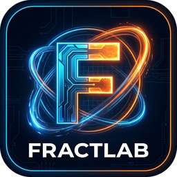
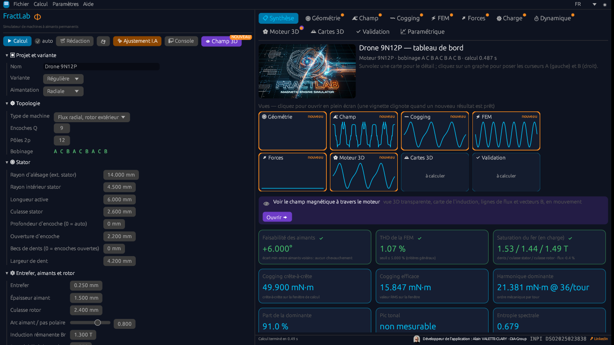
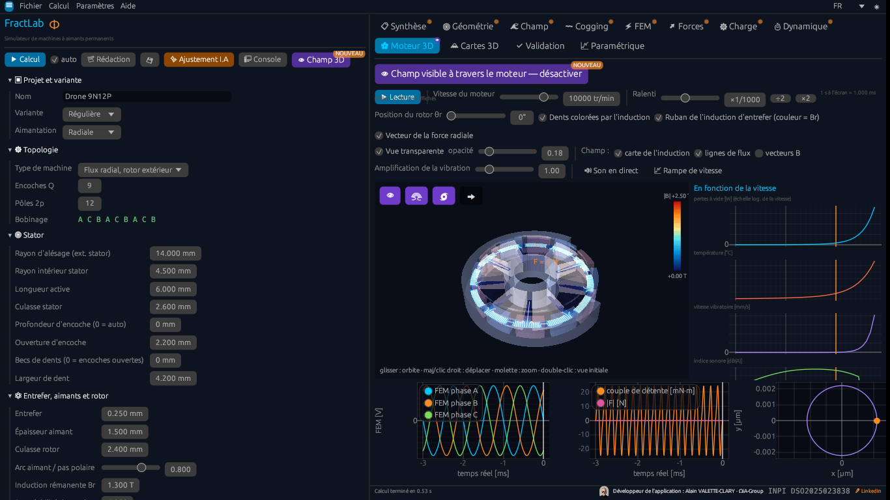

<p align="center"></p>

<h1 align="center">FractLab</h1>

<p align="center">[Français](README.md) · [English](README.en.md) · [Español](README.es.md) · [Italiano](README.it.md) · [Deutsch](README.de.md)</p>

<p align="center">Magnetic Engine Simulator — free analysis software for permanent-magnet machines, a replacement for MATLAB in studies and test benches.</p>

<p align="center">
<a href="https://github.com/OMNIA-AI-Group/FractLab/releases"></a>


</p>

<p align="center"><b>Download the latest version</b><br>
<a href="https://github.com/OMNIA-AI-Group/FractLab/releases/latest/download/FractLab-x86_64.AppImage"></a>
<a href="https://github.com/OMNIA-AI-Group/FractLab/releases/latest/download/FractLab-Setup.exe"></a>
<a href="https://github.com/OMNIA-AI-Group/FractLab/releases/latest/download/FractLab-windows-portable.zip"></a>
<a href="https://github.com/OMNIA-AI-Group/FractLab/releases/latest/download/FractLab.html"></a>
<a href="https://omnia-ai-group.github.io/FractLab/"></a>
</p>



## What is FractLab?

FractLab analyses permanent-magnet motors — outer rotor, inner rotor and axial flux — with an exact analytical model (Maxwell's equations solved by subdomains). Unlike classical tools, it accepts **any magnet layout**, including aperiodic ones (offset magnets, arbitrary positions).

It replaces MATLAB for this work: it opens SIMUMSAP projects and MATLAB `.fig` / `.mat` files without MATLAB, and goes further with live optimisation, saturation, parametric studies and calibration on prototype measurements. Everything runs offline, on every CPU core, in French, English, Spanish and German.

## Features

- **Field and torque**: air-gap flux density, field map with flux lines, cogging torque and spectrum, back-EMF (THD, interharmonics), radial forces and orbit, eccentricity (unbalanced magnetic pull).
- **Topologies**: outer or inner rotor, multi-slice axial flux (1 or 2 air gaps), semi-closed slots, general coil-by-coil winding. Axial machines are drawn as discs (front view, axial section, 3D); field per slice and over the whole disc; transverse force, axial attraction, rotor axial offset and tilt; finite-volume validation in planar geometry.
- **On load**: torque (Maxwell) with energy check, ripple, Kt, inductance matrix + end windings, losses and efficiency.
- **Saturation**: saturation-factor method with real B(H) curves (M270-35A, M400-50A, SMC, 1010 steel): flux densities in teeth and yokes, corrected back-EMF and torque, torque / current curve.
- **Dynamics**: time simulation with grid, PWM inverter, 120° commutation (ESC) or diode rectifier; propeller, conveyor, wind-turbine loads; open-phase and inter-turn faults.
- **Animated 3D motor**: real speed up to 60 000 rpm with slow motion; field, losses, heat, vibration (ISO 10816) and synthesised sound follow the speed. Transparent view with the magnetic field inside: flux density map, flux lines, B vectors.
- **A.I. tuning**: automatic optimisation (cogging, force, back-EMF or trade-off) proposing the 5 best solutions live, applied to every view as it searches.
- **Console and 3D graph**: live trace of every A.I. trial, rotating 3D graph of the explored possibilities, script console to chain computations.
- **Demo** (Help menu): a complete study runs by itself on a demonstration motor (drone, servo motor, hub motor, axial generator); Esc stops it.
- **Parametric study**: one parameter varies, the full motor is recomputed at each value; curves, table, CSV export.
- **Calibration on measurements**: import a measured back-EMF or cogging curve; actual Br, air gap or effective length are fitted.
- **Validation**: built-in independent finite-volume solver (typical deviation 0.3 to 2 %).
- **Criteria**: the dashboard flags every criterion that is not met; one click explains the cause and the fix.
- **Writing**: project sheet → LaTeX / PDF document in 4 languages with the FractLab logo and version, printing, full-save folder.
- **Import / export**: SIMUMSAP projects, MATLAB `.fig`/`.mat` (read and write), FEMM, Gmsh, DXF, 1:1 SVG magnet template, STL, HTML, LaTeX, Octave/MATLAB and Python scripts, CSV, JSON, WAV.



## Download

**Try it online, without installing anything:** https://omnia-ai-group.github.io/FractLab/ (same application, in the browser; calculations run in a background Web Worker and are slower than in the desktop version; files are downloaded, several files as a ZIP archive).

Ready-to-use builds are on the [Releases](https://github.com/OMNIA-AI-Group/FractLab/releases) page:

| File | System | Install |
|---|---|---|
| [`FractLab-x86_64.AppImage`](https://github.com/OMNIA-AI-Group/FractLab/releases/latest/download/FractLab-x86_64.AppImage) | any Linux x86-64 | `chmod +x`, then double-click |
| [`FractLab-Setup.exe`](https://github.com/OMNIA-AI-Group/FractLab/releases/latest/download/FractLab-Setup.exe) | Windows 10/11 | installer |
| [`FractLab-windows-portable.zip`](https://github.com/OMNIA-AI-Group/FractLab/releases/latest/download/FractLab-windows-portable.zip) | Windows 10/11 | unzip, run `FractLab\fractlab.exe` |
| [`FractLab.html`](https://github.com/OMNIA-AI-Group/FractLab/releases/latest/download/FractLab.html) | any system — Chrome, Edge or Firefox | double-click: runs in the browser, offline, nothing to install |

## Building from source

Rust ≥ 1.88 (edition 2024).

```bash
git clone https://github.com/OMNIA-AI-Group/FractLab.git
cd FractLab
cargo build --release
./target/release/fractlab
cargo test --release          # automatic tests
```

Packages: `packaging/build_appimage.sh` (needs `appimagetool`, path in `APPIMAGETOOL`) and `packaging/build_windows.sh` (cross-compiled from Linux with MinGW-w64 and NSIS). Browser version: `packaging/build_web.sh` (target `wasm32-unknown-unknown` + `wasm-bindgen-cli`).

## Documentation

- [CHANGELOG.md](CHANGELOG.md) — release notes (French, with English summaries).
- Built-in user guide in 4 languages (F1) and hover help on every setting.
- [docs/ARCHITECTURE.md](docs/ARCHITECTURE.md) — code organisation, [docs/MODELE.md](docs/MODELE.md) — model equations.
- Code documentation: `cargo doc --no-deps --open`.

## Model assumptions

Exact 2D subdomain model (multi-slice for axial flux), infinite-permeability iron corrected by the saturation-factor method, uniform-permeability magnets, end windings estimated by a permeance coefficient, constant-inductance dynamic simulation. Validated against an independent finite-volume solver and compared with SIMUMSAP. Not covered: nonlinear finite elements, induction machines.

## Licence

FractLab is free software released under the **GNU General Public License v3.0 or later** — see [LICENSE](LICENSE).

Third-party components: egui · eframe · egui_plot (MIT/Apache-2.0), image, rfd, serde, flate2, dirs (MIT/Apache-2.0).

## Author

**Alain VALETTE-CLARY** — ΩiA-Group · INPI DSO2025023838 · [LinkedIn](https://www.linkedin.com/in/alain-valette-clary-524b28352/)

© 2026 Alain VALETTE-CLARY / ΩiA-Group
