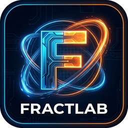
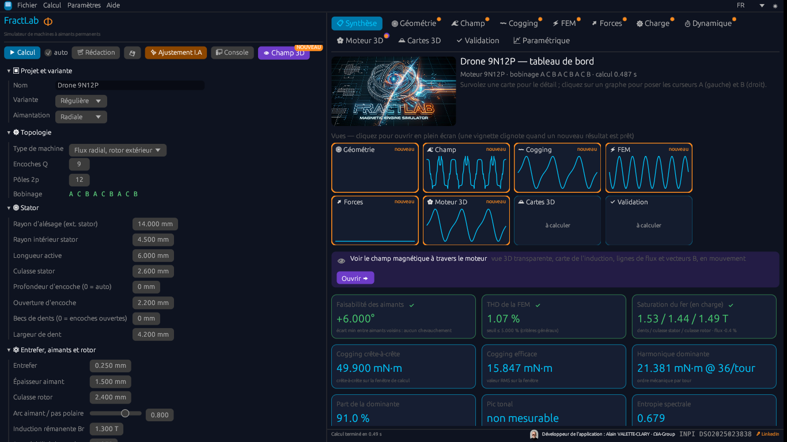
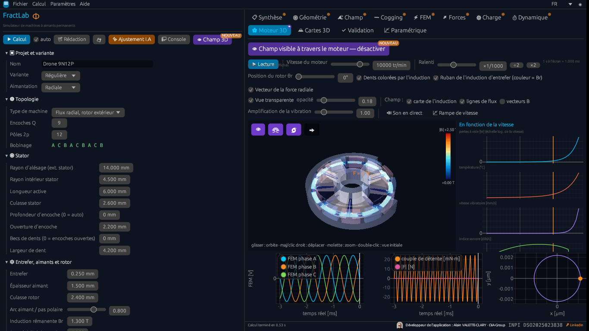

<p align="center"></p>

<h1 align="center">FractLab</h1>

<p align="center">[Français](README.md) · [English](README.en.md) · [Español](README.es.md) · [Italiano](README.it.md) · [Deutsch](README.de.md)</p>

<p align="center">Magnetic Engine Simulator — software libre de análisis de máquinas de imanes permanentes, que sustituye a MATLAB en estudios y bancos de ensayo.</p>

<p align="center">
<a href="https://github.com/OMNIA-AI-Group/FractLab/releases"></a>


</p>

<p align="center"><b>Descargar la última versión</b><br>
<a href="https://github.com/OMNIA-AI-Group/FractLab/releases/latest/download/FractLab-x86_64.AppImage"></a>
<a href="https://github.com/OMNIA-AI-Group/FractLab/releases/latest/download/FractLab-Setup.exe"></a>
<a href="https://github.com/OMNIA-AI-Group/FractLab/releases/latest/download/FractLab-windows-portable.zip"></a>
<a href="https://github.com/OMNIA-AI-Group/FractLab/releases/latest/download/FractLab.html"></a>
<a href="https://omnia-ai-group.github.io/FractLab/"></a>
</p>



## ¿Qué es FractLab?

FractLab analiza motores de imanes permanentes — rotor exterior, rotor interior y flujo axial — con un modelo analítico exacto (ecuaciones de Maxwell resueltas por subdominios). A diferencia de las herramientas clásicas, acepta **cualquier distribución de imanes**, incluso aperiódica (imanes desplazados, posiciones cualesquiera).

Sustituye a MATLAB para este trabajo: abre proyectos SIMUMSAP y archivos MATLAB `.fig` / `.mat` sin MATLAB, y va más allá con optimización en directo, saturación, estudios paramétricos y calibración con medidas del prototipo. Todo funciona sin conexión, en todos los núcleos del procesador, en francés, inglés, español y alemán.

## Funciones

- **Campo y par**: inducción en el entrehierro, mapa del campo con líneas de flujo, par de cogging y espectro, FCEM (THD, interarmónicos), fuerzas radiales y órbita, excentricidad (atracción magnética desequilibrada).
- **Topologías**: rotor exterior o interior, flujo axial multicapa (1 o 2 entrehierros), ranuras semicerradas, devanado general bobina a bobina. Las máquinas axiales se dibujan en discos (vista frontal, corte axial, 3D); campo por capa y en todo el disco; fuerza transversal, atracción axial, desplazamiento axial e inclinación del rotor; validación por volúmenes finitos en geometría plana.
- **En carga**: par (Maxwell) con control energético, rizado, Kt, matriz de inductancias + cabezas de bobina, pérdidas y rendimiento.
- **Saturación**: método del factor de saturación con curvas B(H) reales (M270-35A, M400-50A, SMC, acero 1010): inducciones en dientes y yugos, FCEM y par corregidos, curva par / corriente.
- **Dinámica**: simulación temporal con red, inversor MLI, conmutación 120° (ESC) o rectificador de diodos; cargas hélice, transportador, aerogenerador; defectos de fase abierta y cortocircuito entre espiras.
- **Motor 3D animado**: velocidad real hasta 60 000 rpm con cámara lenta; campo, pérdidas, calor, vibración (ISO 10816) y sonido sintetizado siguen la velocidad. Vista transparente con el campo magnético en el interior: mapa de inducción, líneas de flujo, vectores B.
- **Ajuste I.A**: optimización automática (cogging, fuerza, FCEM o compromiso) que propone en directo las 5 mejores soluciones, aplicadas a todas las vistas durante la búsqueda.
- **Consola y grafo 3D**: desarrollo en directo de cada ensayo de la I.A, grafo 3D giratorio de las posibilidades exploradas, consola de script para encadenar cálculos.
- **Demo** (menú Ayuda): un estudio completo se desarrolla solo con un motor de demostración (dron, servomotor, motor de rueda, generador axial); Esc la detiene.
- **Estudio paramétrico**: un parámetro varía y el motor completo se recalcula en cada valor; curvas, tabla, exportación CSV.
- **Calibración con medidas**: importe una FCEM o un cogging medidos; se ajustan la Br real, el entrehierro o la longitud efectiva.
- **Validación**: solver de volúmenes finitos independiente integrado (desviación típica del 0,3 al 2 %).
- **Criterios**: el tablero señala cada criterio no cumplido; un clic explica la causa y la corrección.
- **Redacción**: ficha del proyecto → documento LaTeX / PDF en 4 idiomas con el logotipo y la versión de FractLab, impresión, carpeta de guardado general.
- **Importación / exportación**: proyectos SIMUMSAP, MATLAB `.fig`/`.mat` (lectura y escritura), FEMM, Gmsh, DXF, plantilla de colocación de imanes 1:1 en SVG, STL, HTML, LaTeX, scripts Octave/MATLAB y Python, CSV, JSON, WAV.



## Descarga

**Probar en línea, sin instalar nada:** https://omnia-ai-group.github.io/FractLab/ (la misma aplicación, en el navegador; los cálculos se ejecutan en un Web Worker en segundo plano y son más lentos que en la versión de escritorio; los archivos se descargan, varios archivos en un ZIP).

Las versiones listas para usar están en la página [Releases](https://github.com/OMNIA-AI-Group/FractLab/releases):

| Archivo | Sistema | Instalación |
|---|---|---|
| [`FractLab-x86_64.AppImage`](https://github.com/OMNIA-AI-Group/FractLab/releases/latest/download/FractLab-x86_64.AppImage) | cualquier Linux x86-64 | `chmod +x` y doble clic |
| [`FractLab-Setup.exe`](https://github.com/OMNIA-AI-Group/FractLab/releases/latest/download/FractLab-Setup.exe) | Windows 10/11 | instalador |
| [`FractLab-windows-portable.zip`](https://github.com/OMNIA-AI-Group/FractLab/releases/latest/download/FractLab-windows-portable.zip) | Windows 10/11 | descomprimir y ejecutar `FractLab\fractlab.exe` |
| [`FractLab.html`](https://github.com/OMNIA-AI-Group/FractLab/releases/latest/download/FractLab.html) | cualquier sistema — Chrome, Edge o Firefox | doble clic: funciona en el navegador, sin conexión, nada que instalar |

## Compilar desde el código fuente

Rust ≥ 1.88 (edición 2024).

```bash
git clone https://github.com/OMNIA-AI-Group/FractLab.git
cd FractLab
cargo build --release
./target/release/fractlab
cargo test --release          # pruebas automáticas
```

Paquetes: `packaging/build_appimage.sh` (requiere `appimagetool`, ruta en `APPIMAGETOOL`) y `packaging/build_windows.sh` (compilación cruzada desde Linux con MinGW-w64 y NSIS). Versión de navegador: `packaging/build_web.sh` (objetivo `wasm32-unknown-unknown` + `wasm-bindgen-cli`).

## Documentación

- [CHANGELOG.md](CHANGELOG.md) — registro de versiones (en francés, con resumen en inglés).
- Guía de uso integrada en 4 idiomas (F1) y ayuda emergente en cada ajuste.
- [docs/ARCHITECTURE.md](docs/ARCHITECTURE.md) — organización del código, [docs/MODELE.md](docs/MODELE.md) — ecuaciones del modelo (en francés).
- Documentación del código: `cargo doc --no-deps --open`.

## Hipótesis del modelo

Modelo 2D exacto por subdominios (multicapa para flujo axial), hierro de permeabilidad infinita corregido por el método del factor de saturación, imanes de permeabilidad uniforme, cabezas de bobina estimadas con un coeficiente de permeancia, simulación dinámica con inductancia constante. Validado con un solver de volúmenes finitos independiente y comparado con SIMUMSAP. No cubierto: elementos finitos no lineales, máquinas asíncronas.

## Licencia

FractLab es software libre publicado bajo la **Licencia Pública General GNU v3.0 o posterior** — ver [LICENSE](LICENSE).

Componentes de terceros: egui · eframe · egui_plot (MIT/Apache-2.0), image, rfd, serde, flate2, dirs (MIT/Apache-2.0).

## Autor

**Alain VALETTE-CLARY** — ΩiA-Group · INPI DSO2025023838 · [LinkedIn](https://www.linkedin.com/in/alain-valette-clary-524b28352/)

© 2026 Alain VALETTE-CLARY / ΩiA-Group
