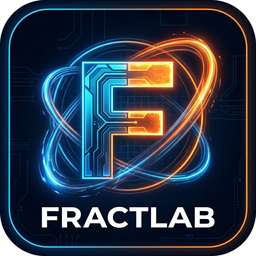
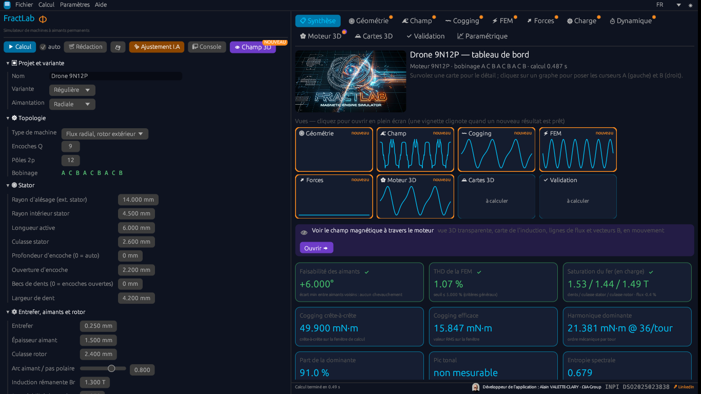
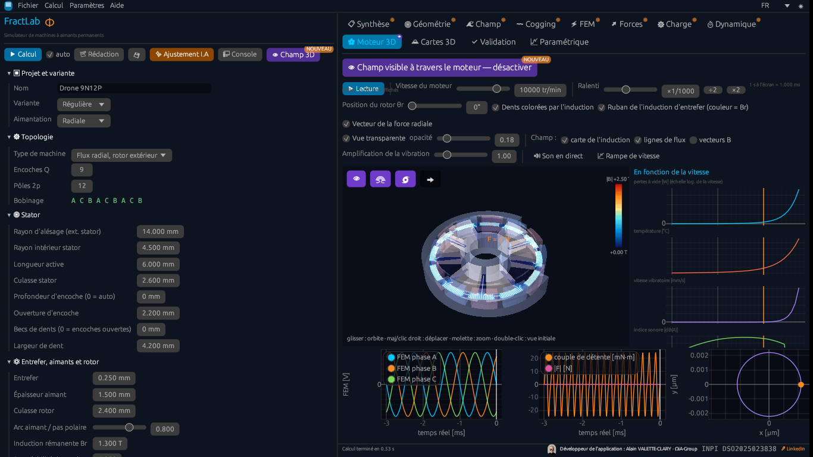

<p align="center"></p>

<h1 align="center">FractLab</h1>

<p align="center">[Français](README.md) · [English](README.en.md) · [Español](README.es.md) · [Italiano](README.it.md) · [Deutsch](README.de.md)</p>

<p align="center">Magnetic Engine Simulator — software libero di analisi delle macchine a magneti permanenti, che sostituisce MATLAB per studi e banchi di prova.</p>

<p align="center">
<a href="https://github.com/OMNIA-AI-Group/FractLab/releases"></a>


</p>



## Che cos'è FractLab?

FractLab analizza i motori a magneti permanenti — rotore esterno, rotore interno e flusso assiale — con un modello analitico esatto (equazioni di Maxwell risolte per sottodomini). A differenza degli strumenti classici, accetta **qualsiasi disposizione dei magneti**, anche aperiodica (magneti sfalsati, posizioni qualsiasi).

Sostituisce MATLAB per questo lavoro: apre i progetti SIMUMSAP e i file MATLAB `.fig` / `.mat` senza MATLAB, e va oltre con l'ottimizzazione in tempo reale, la saturazione, gli studi parametrici e la calibrazione sulle misure del prototipo. Tutto funziona offline, su tutti i core del processore. L'interfaccia è in francese, inglese, spagnolo e tedesco.

## Funzioni

- **Campo e coppia**: induzione al traferro, mappa del campo con linee di flusso, coppia di cogging e spettro, FEM (THD, interarmoniche), forze radiali e orbita, eccentricità (attrazione magnetica sbilanciata).
- **Topologie**: rotore esterno o interno, flusso assiale multistrato (1 o 2 traferri), cave semichiuse, avvolgimento generale bobina per bobina. Le macchine assiali sono disegnate come dischi (vista frontale, sezione assiale, 3D); campo per strato e su tutto il disco; forza trasversale, attrazione assiale, spostamento assiale e inclinazione del rotore; validazione ai volumi finiti in geometria piana.
- **Sotto carico**: coppia (Maxwell) con controllo energetico, ondulazione, Kt, matrice delle induttanze + testate, perdite e rendimento.
- **Saturazione**: metodo del fattore di saturazione con curve B(H) reali (M270-35A, M400-50A, SMC, acciaio 1010): induzioni nei denti e nei gioghi, FEM e coppia corrette, curva coppia / corrente.
- **Dinamica**: simulazione nel tempo con rete, inverter PWM, commutazione 120° (ESC) o raddrizzatore a diodi; carichi elica, nastro trasportatore, turbina eolica; guasti di fase aperta e cortocircuito tra spire.
- **Motore 3D animato**: velocità reale fino a 60 000 giri/min con rallentatore; campo, perdite, calore, vibrazione (ISO 10816) e suono sintetizzato seguono la velocità. Vista trasparente con il campo magnetico all'interno: mappa dell'induzione, linee di flusso, vettori B.
- **Regolazione I.A**: ottimizzazione automatica (cogging, forza, FEM o compromesso) che propone in tempo reale le 5 migliori soluzioni, applicate a tutte le viste durante la ricerca.
- **Console e grafo 3D**: svolgimento in diretta di ogni prova dell'I.A, grafo 3D rotante delle possibilità esplorate, console di script per concatenare calcoli.
- **Demo** (menu Aiuto): uno studio completo si svolge da solo su un motore dimostrativo (drone, servomotore, motore a ruota, generatore assiale); Esc la ferma.
- **Studio parametrico**: un parametro varia e il motore completo viene ricalcolato per ogni valore; curve, tabella, esportazione CSV.
- **Calibrazione sulle misure**: importate una FEM o un cogging misurati; vengono adattati Br reale, traferro o lunghezza efficace.
- **Validazione**: risolutore ai volumi finiti indipendente integrato (scarto tipico dallo 0,3 al 2 %).
- **Criteri**: il cruscotto segnala ogni criterio non rispettato; un clic ne spiega la causa e la correzione.
- **Redazione**: scheda del progetto → documento LaTeX / PDF in 4 lingue con il logo e la versione di FractLab, stampa, cartella di salvataggio completo.
- **Importazione / esportazione**: progetti SIMUMSAP, MATLAB `.fig`/`.mat` (lettura e scrittura), FEMM, Gmsh, DXF, dima di posa dei magneti 1:1 in SVG, STL, HTML, LaTeX, script Octave/MATLAB e Python, CSV, JSON, WAV.



## Download

**Provalo online, senza installare nulla:** https://omnia-ai-group.github.io/FractLab/ (la stessa applicazione, nel browser; i calcoli girano in un Web Worker in background e sono più lenti che nella versione desktop; i file vengono scaricati, più file in un archivio ZIP).

Le versioni pronte all'uso sono nella pagina [Releases](https://github.com/OMNIA-AI-Group/FractLab/releases):

| File | Sistema | Installazione |
|---|---|---|
| `FractLab-<version>-x86_64.AppImage` | qualsiasi Linux x86-64 | `chmod +x`, poi doppio clic |
| `FractLab-<version>-Setup.exe` | Windows 10/11 | programma di installazione |
| `FractLab-<version>-windows-portable.zip` | Windows 10/11 | estrarre ed eseguire `FractLab\fractlab.exe` |
| `FractLab-<version>.html` | qualsiasi sistema — Chrome, Edge o Firefox | doppio clic: funziona nel browser, offline, nulla da installare |

## Compilare dai sorgenti

Rust ≥ 1.88 (edizione 2024).

```bash
git clone https://github.com/OMNIA-AI-Group/FractLab.git
cd FractLab
cargo build --release
./target/release/fractlab
cargo test --release          # test automatici
```

Pacchetti: `packaging/build_appimage.sh` (richiede `appimagetool`, percorso in `APPIMAGETOOL`) e `packaging/build_windows.sh` (compilazione incrociata da Linux con MinGW-w64 e NSIS). Versione browser: `packaging/build_web.sh` (target `wasm32-unknown-unknown` + `wasm-bindgen-cli`).

## Documentazione

- [CHANGELOG.md](CHANGELOG.md) — registro delle versioni (in francese, con riassunto in inglese).
- Guida integrata in 4 lingue (F1) e suggerimenti al passaggio del mouse su ogni impostazione.
- [docs/ARCHITECTURE.md](docs/ARCHITECTURE.md) — organizzazione del codice, [docs/MODELE.md](docs/MODELE.md) — equazioni del modello (in francese).
- Documentazione del codice: `cargo doc --no-deps --open`.

## Ipotesi del modello

Modello 2D esatto per sottodomini (multistrato per il flusso assiale), ferro a permeabilità infinita corretto con il metodo del fattore di saturazione, magneti a permeabilità uniforme, testate stimate con un coefficiente di permeanza, simulazione dinamica a induttanza costante. Validato con un risolutore ai volumi finiti indipendente e confrontato con SIMUMSAP. Non coperto: elementi finiti non lineari, macchine asincrone.

## Licenza

FractLab è software libero distribuito con la **GNU General Public License v3.0 o successiva** — vedere [LICENSE](LICENSE).

Componenti di terze parti: egui · eframe · egui_plot (MIT/Apache-2.0), image, rfd, serde, flate2, dirs (MIT/Apache-2.0).

## Autore

**Alain VALETTE-CLARY** — ΩiA-Group · INPI DSO2025023838 · [LinkedIn](https://www.linkedin.com/in/alain-valette-clary-524b28352/)

© 2026 Alain VALETTE-CLARY / ΩiA-Group
