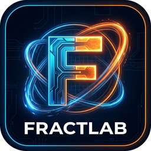
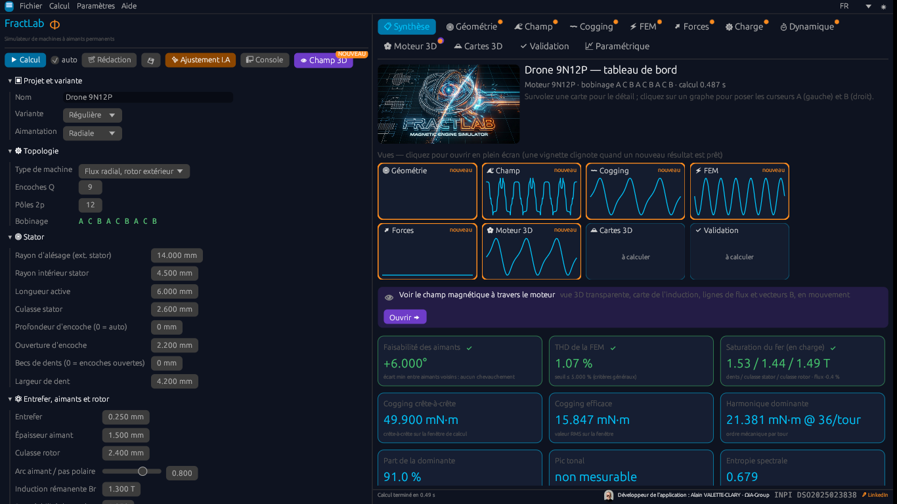
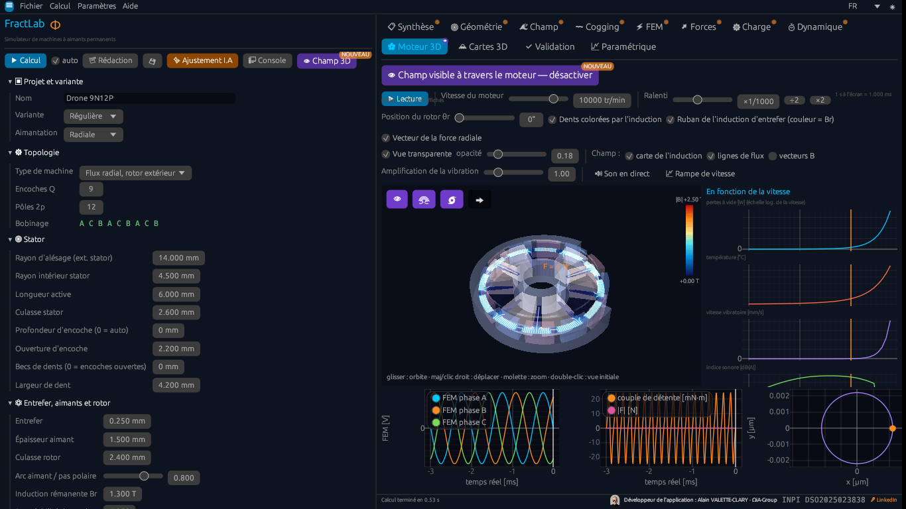

<p align="center"></p>

<h1 align="center">FractLab</h1>

<p align="center">[Français](README.md) · [English](README.en.md) · [Español](README.es.md) · [Italiano](README.it.md) · [Deutsch](README.de.md)</p>

<p align="center">Magnetic Engine Simulator — logiciel libre d'analyse des machines à aimants permanents, qui remplace MATLAB pour les études et les bancs d'essai.</p>

<p align="center">
<a href="https://github.com/OMNIA-AI-Group/FractLab/releases"></a>


</p>

<p align="center"><b>Télécharger la dernière version</b><br>
<a href="https://github.com/OMNIA-AI-Group/FractLab/releases/latest/download/FractLab-x86_64.AppImage"></a>
<a href="https://github.com/OMNIA-AI-Group/FractLab/releases/latest/download/FractLab-Setup.exe"></a>
<a href="https://github.com/OMNIA-AI-Group/FractLab/releases/latest/download/FractLab-windows-portable.zip"></a>
<a href="https://github.com/OMNIA-AI-Group/FractLab/releases/latest/download/FractLab.html"></a>
<a href="https://omnia-ai-group.github.io/FractLab/"></a>
</p>



## Qu'est-ce que FractLab ?

FractLab analyse les moteurs à aimants permanents — rotor extérieur, rotor intérieur et flux axial — avec un modèle analytique exact (équations de Maxwell résolues par sous-domaines). Contrairement aux outils classiques, il accepte **n'importe quelle répartition des aimants**, y compris apériodique (aimants décalés, positions quelconques).

Il remplace MATLAB pour ce travail : il ouvre les projets SIMUMSAP et les fichiers MATLAB `.fig` / `.mat` sans MATLAB, et va plus loin avec l'optimisation en direct, la saturation, les études paramétriques et le recalage sur les mesures du prototype. Tout fonctionne hors ligne, sur tous les cœurs du processeur, en français, anglais, espagnol et allemand.

## Fonctions

- **Champ et couple** : induction d'entrefer, carte du champ avec lignes de flux, couple de détente et spectre, FEM (THD, interharmoniques), forces radiales et orbite, excentricité (attraction magnétique déséquilibrée).
- **Topologies** : rotor extérieur ou intérieur, flux axial multi-tranches (1 ou 2 entrefers), encoches semi-fermées, bobinage général bobine par bobine. Les machines axiales sont dessinées en disques (vue de face, coupe axiale, 3D) ; champ par tranche et sur tout le disque ; force transverse, attraction axiale, décalage axial et inclinaison du rotor ; validation par volumes finis en géométrie plane.
- **En charge** : couple (Maxwell) avec contrôle énergétique, ondulation, Kt, matrice d'inductances + têtes de bobines, pertes et rendement.
- **Saturation** : méthode du facteur de saturation avec de vraies courbes B(H) (M270-35A, M400-50A, SMC, acier 1010) : inductions dans les dents et les culasses, FEM et couple corrigés, courbe couple / courant.
- **Dynamique** : simulation temporelle avec réseau, onduleur MLI, commutation 120° (ESC) ou redresseur à diodes ; charges hélice, convoyeur, éolienne ; défauts phase ouverte et court-circuit entre spires.
- **Moteur 3D animé** : vitesse réelle jusqu'à 60 000 tr/min avec ralenti ; champ, pertes, chaleur, vibration (ISO 10816) et son synthétisé suivent la vitesse. Vue transparente avec le champ magnétique à l'intérieur : carte de l'induction, lignes de flux, vecteurs B.
- **Ajustement I.A** : optimisation automatique (cogging, force, FEM ou compromis) qui propose en direct les 5 meilleures solutions, appliquées à toutes les vues pendant la recherche.
- **Console et graphe 3D** : déroulé en direct de chaque essai de l'I.A, graphe 3D tournant des possibilités explorées, console de script pour enchaîner des calculs.
- **Démo** (menu Aide) : une étude complète se déroule toute seule sur un moteur de démonstration (drone, servomoteur, moteur-roue, génératrice axiale) ; Échap l'arrête.
- **Étude paramétrique** : un paramètre varie, le moteur complet est recalculé à chaque valeur ; courbes, tableau, export CSV.
- **Recalage sur mesures** : importez une FEM ou un cogging mesurés ; Br réelle, entrefer ou longueur effective sont ajustés.
- **Validation** : solveur volumes finis indépendant intégré (écart typique de 0,3 à 2 %).
- **Critères** : le tableau de bord signale chaque critère non tenu ; un clic en explique la cause et la correction.
- **Rédaction** : fiche du projet → document LaTeX / PDF en 4 langues portant le logo et la version de FractLab, impression, dossier de sauvegarde générale.
- **Imports / exports** : projets SIMUMSAP, MATLAB `.fig`/`.mat` (lecture et écriture), FEMM, Gmsh, DXF, gabarit de pose des aimants 1:1 en SVG, STL, HTML, LaTeX, scripts Octave/MATLAB et Python, CSV, JSON, WAV.



## Téléchargement

**Essayer en ligne, sans rien installer :** https://omnia-ai-group.github.io/FractLab/ (même application, dans le navigateur ; les calculs tournent dans un Web Worker en arrière-plan et sont plus lents que dans la version de bureau ; les fichiers sont téléchargés, plusieurs fichiers dans une archive ZIP).

Les versions prêtes à l'emploi sont sur la page [Releases](https://github.com/OMNIA-AI-Group/FractLab/releases) :

| Fichier | Système | Installation |
|---|---|---|
| [`FractLab-x86_64.AppImage`](https://github.com/OMNIA-AI-Group/FractLab/releases/latest/download/FractLab-x86_64.AppImage) | tout Linux x86-64 | `chmod +x`, puis double-clic |
| [`FractLab-Setup.exe`](https://github.com/OMNIA-AI-Group/FractLab/releases/latest/download/FractLab-Setup.exe) | Windows 10/11 | installateur |
| [`FractLab-windows-portable.zip`](https://github.com/OMNIA-AI-Group/FractLab/releases/latest/download/FractLab-windows-portable.zip) | Windows 10/11 | dézipper, lancer `FractLab\fractlab.exe` |
| [`FractLab.html`](https://github.com/OMNIA-AI-Group/FractLab/releases/latest/download/FractLab.html) | tout système — Chrome, Edge ou Firefox | double-clic : fonctionne dans le navigateur, hors ligne, rien à installer |

## Compiler depuis les sources

Rust ≥ 1.88 (édition 2024).

```bash
git clone https://github.com/OMNIA-AI-Group/FractLab.git
cd FractLab
cargo build --release
./target/release/fractlab
cargo test --release          # tests automatiques
```

Paquets : `packaging/build_appimage.sh` (nécessite `appimagetool`, chemin dans `APPIMAGETOOL`) et `packaging/build_windows.sh` (compilation croisée depuis Linux avec MinGW-w64 et NSIS). Version navigateur : `packaging/build_web.sh` (cible `wasm32-unknown-unknown` + `wasm-bindgen-cli`).

## Documentation

- [CHANGELOG.md](CHANGELOG.md) — journal des versions.
- Guide d'utilisation intégré en 4 langues (F1) et bulle d'aide sur chaque réglage.
- [docs/ARCHITECTURE.md](docs/ARCHITECTURE.md) — organisation du code, [docs/MODELE.md](docs/MODELE.md) — équations du modèle.
- Documentation du code : `cargo doc --no-deps --open`.

## Hypothèses du modèle

Modèle 2D exact en sous-domaines (multi-tranches pour le flux axial), fer de perméabilité infinie corrigé par la méthode du facteur de saturation, aimants de perméabilité uniforme, têtes de bobines estimées par un coefficient de perméance, simulation dynamique à inductance constante. Validé contre un solveur volumes finis indépendant et comparé à SIMUMSAP. Non couvert : éléments finis non linéaires, machines asynchrones.

## Licence

FractLab est un logiciel libre publié sous **licence publique générale GNU v3.0 ou ultérieure** — voir [LICENSE](LICENSE).

Composants tiers : egui · eframe · egui_plot (MIT/Apache-2.0), image, rfd, serde, flate2, dirs (MIT/Apache-2.0).

## Auteur

**Alain VALETTE-CLARY** — ΩiA-Group · INPI DSO2025023838 · [LinkedIn](https://www.linkedin.com/in/alain-valette-clary-524b28352/)

© 2026 Alain VALETTE-CLARY / ΩiA-Group
